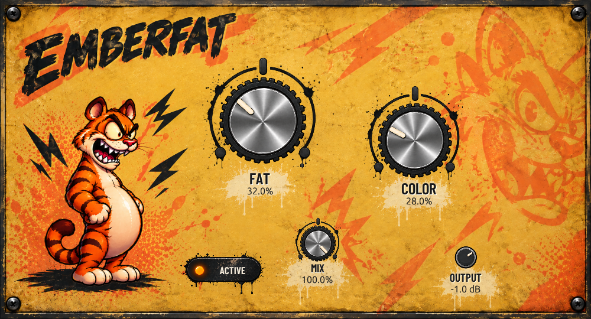

# EmberFat

[](https://github.com/0xPRISMM/EmberFat/actions/workflows/windows-release.yml)

EmberFat is a stereo saturation effect built with Rust and [NIH-plug](https://github.com/robbert-vdh/nih-plug). It provides four focused controls for shaping drive, tone, blend, and output level.



## Audio processing in 0.2.0

Knob changes ramp over 20 ms; ACTIVE/BYPASSED crossfades over 5 ms. Host automation is sample accurate. An original soft saturation curve runs at 4x sample rate with FIR anti-alias filters. COLOR introduces asymmetric harmonics and softens the added distortion; DC filtering applies only to that distortion.

FAT at zero is clean at unity OUTPUT. MIX at zero and BYPASSED preserve the original signal, including headroom. All paths have the same fixed 48-sample latency, reported to the host for delay compensation. OUTPUT still controls the wet signal before MIX.

The revised gain compensation and curve change the sound of existing presets. Parameter IDs and the VST3 class ID remain stable. See the [DSP review and validation](docs/DSP_REVIEW.md) for measurements and comparisons.

## Controls

- FAT drive and saturation
- COLOR harmonic character
- MIX dry/wet blend
- OUTPUT processed-signal level, before the dry/wet blend
- ACTIVE/BYPASSED comparison and double-click reset
- Shift-drag for fine control, click a value to type, arrow keys and mouse wheel adjustment
- VST3 plugin with stereo I/O

## Download for Windows

1. Open [GitHub Releases](https://github.com/0xPRISMM/EmberFat/releases/latest).
2. Download `EmberFat-0.2.0-Windows-Setup.exe` and run it.
3. Close your DAW before installing, choose the VST3 installation folder, then reopen the DAW and rescan plugins.

The release also provides a VST3 ZIP for manual installation and SHA256 checksums for both downloads.

Development builds remain available from the [Windows build workflow](https://github.com/0xPRISMM/EmberFat/actions/workflows/windows-release.yml). Workflow artifacts expire after 30 days; versioned release downloads remain available under Releases.

## Build from source

Install the stable Rust toolchain and a native C/C++ build toolchain for your platform, then run:

```sh
cargo test --workspace
cargo run --package xtask -- bundle emberfat --release
```

The VST3 bundle is generated under `target/bundled/`. For the complete Windows package, install Inno Setup 6 and run:

```powershell
./scripts/package-windows.ps1
```

Use `-InnoCompiler 'C:/path/to/ISCC.exe'` for a custom installation. This builds the VST3, stages a fresh bundle with UI asset licenses, and creates the installer and checksum in `dist/`.

## Repository layout

```text
.github/workflows/   CI build and release artifact workflow
docs/                Release roadmap and project notes
installer/windows/   Inno Setup installer definition
plugin/              EmberFat plugin source and manifest
scripts/             Repeatable Windows packaging
xtask/               NIH-plug bundling task
```

Build outputs and installers are generated in `target/` and `dist/`; they are intentionally not stored in the source repository.

## Licensing

Barlow Condensed is embedded under the SIL Open Font License 1.1; see [UI asset notices](THIRD_PARTY_NOTICES.md). The plugin crate declares `GPL-3.0-or-later` in `plugin/Cargo.toml`. Review NIH-plug and dependency licensing before redistributing builds.
